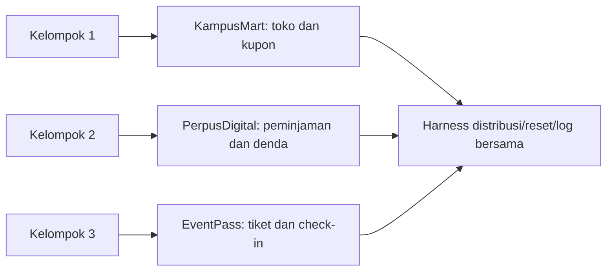

# Arsitektur lab VAPT lokal — tiga aplikasi target berbeda

**Status:** spesifikasi pembangunan, revisi 26 Oktober 2026. Nama berkas mempertahankan tautan rancangan lama; isi ini menggantikan rancangan tiga varian KampusMart.  
**Keputusan:** kelompok 1 menguji KampusMart, kelompok 2 PerpusDigital, kelompok 3 EventPass. Setiap kelompok memperoleh **satu paket targetnya sendiri**, bukan tiga varian satu codebase.  
**Metodologi:** PTES; akses paket atau instance hanya setelah form ROE kelompok disetujui dan ditandatangani.

## 1. Prinsip bentuk aplikasi

Tiga aplikasi mempunyai domain, alur bisnis, model data, endpoint, antarmuka, dan kelemahan yang berbeda. Pengajar boleh memakai pustaka/harness bersama untuk start, seed, reset, health check, logging, dan versi patched; **logika aplikasi dan fixture utama tidak dibagi**. Setiap paket menyediakan UI HTML sederhana plus API JSON dan SQLite tertanam, tanpa database server, VM attacker, SIEM, atau frontend SPA besar. Data dan akun semuanya sintetis.



| Target | Komponen selalu berjalan | Alur normal dan data minimum | Komponen tambahan |
| --- | --- | --- | --- |
| KampusMart | Aplikasi web/API + SQLite | Dua pelanggan, satu staf, katalog 10–20 produk, pesanan, invoice, kupon | Sidecar Apache rentan **opsional** untuk marker file sintetis |
| PerpusDigital | Aplikasi web/API + SQLite | Dua anggota, satu petugas, katalog 10–20 buku, peminjaman, pengembalian, denda | Tidak ada |
| EventPass | Aplikasi web/API + SQLite | Dua peserta, satu penyelenggara, 3–5 acara, tiket, ulasan, check-in | Tidak ada |

Setiap app berisi beberapa alur yang **berfungsi normal**. Peserta harus dapat mengamati perilaku sah sebelum mencari penyimpangan. Buat log request ID dan event perubahan state tanpa password/token. Sediakan satu panel atau perintah reset per target yang mengembalikan fixture awal.

## 2. Peta temuan instruktur dan retest

Bagian ini **untuk instruktur**, tidak ikut paket peserta. Kartu target mahasiswa hanya memberikan cerita, area uji, dan pertanyaan.

| Target | Kondisi rentan yang dibangun | Pembuktian terbatas | Perbaikan pada build patched |
| --- | --- | --- | --- |
| KampusMart | Apache build/config terdampak; invoice diambil tanpa cek pemilik; kupon dapat dipakai ulang | Satu file marker; satu invoice milik akun uji lain; satu state kupon | Upgrade/config Apache; otorisasi per invoice; pemeriksaan pemakaian kupon atomik di server |
| PerpusDigital | Query pencarian membentuk SQL dari input; fungsi ubah metadata buku memeriksa UI saja; denda dapat dibebaskan sebelum pengembalian | Satu record marker; satu perubahan metadata sintetis; satu state denda | Parameterized query; otorisasi fungsi pada server; validasi state dan transaksi denda |
| EventPass | Ulasan ditampilkan tanpa encoding sesuai konteks; endpoint update menerima properti tiket terlarang; scan kedua tetap dicatat | Indikator DOM lokal pada akun uji kedua; satu properti tiket sintetis berubah; dua catatan check-in satu tiket | Output encoding; allowlist field dan otorisasi properti; transisi check-in satu kali yang atomik |

OWASP membedakan [SQL injection](https://community.owasp.org/attacks/SQL_Injection), [XSS](https://community.owasp.org/attacks/xss/), [otorisasi properti objek](https://api-security.owasp.org/editions/2023/en/0xa3-broken-object-property-level-authorization/), dan [otorisasi fungsi](https://api-security.owasp.org/editions/2023/en/0xa5-broken-function-level-authorization/). Pembedaan ini menjadi dasar kasus yang berbeda, sementara rubrik PTES tetap sama.

**Kesetaraan:** tiga temuan per target, masing-masing satu bukti minimum, satu kontrol yang dapat dijelaskan, dan satu retest. Jangan mengasumsikan kategorinya otomatis setara; blind pilot harus mengukur waktu, jumlah langkah, titik buntu, serta waktu retest. Kalibrasi hint atau fixture jika satu target jauh lebih sulit.

## 3. Isolasi dan pencegahan penyalinan laporan

- Satu kelompok hanya menerima image, seed, akun, kartu tugas, dan scope miliknya. Jangan bagikan image semua target ke seluruh peserta.
- Kunci instruktur berisi mapping temuan, expected response, dan marker unik untuk masing-masing target. Marker dapat dihasilkan dari seed kelompok, tetapi **bukan** satu-satunya dasar nilai karena image lokal dapat diperiksa.
- Bukti wajib menyebut ID request, kondisi awal, peran, hasil aktual/semestinya, akar masalah, dan hasil retest. Pertanyaan lisan individual meminta anggota menerangkan satu bukti atau keputusan yang dikerjakannya.
- Berikan variasi kecil dalam ID objek dan marker di target yang sama jika suatu saat satu target dipakai lebih dari satu kelompok. Untuk desain sekarang, perbedaan **aplikasi** adalah pencegah plagiasi utama.
- Kunci jawaban dan patched build disimpan instruktur; patched build dirilis saat fase retest, bukan bersamaan dengan target rentan.

## 4. Anggaran laptop dan paket

Angka berikut adalah **target desain yang harus dibuktikan pilot**, bukan hasil pengukuran. Hanya **satu** target berjalan pada satu laptop.

| Target | Batas RAM container | Batas CPU | Ukuran image + volume + patched build |
| --- | ---: | ---: | ---: |
| KampusMart app + SQLite | 768 MB | 1 vCPU | <5 GB |
| Apache sidecar saat dibutuhkan | 256 MB | 0,5 vCPU | Termasuk batas KampusMart |
| PerpusDigital app + SQLite | ≤768 MB | ≤1 vCPU | <5 GB |
| EventPass app + SQLite | ≤768 MB | ≤1 vCPU | <5 GB |

**Kelayakan perangkat:** RAM 8 GB, CPU 4 core, dan ruang kosong ≥20 GB sebagai minimum **bersyarat** setelah pilot; RAM 16 GB dan ≥30 GB ruang kosong lebih nyaman. Browser dan proxy memakai RAM di luar container. Target pilot: idle <500 MB, puncak <1 GB per laptop, start <3 menit, reset <2 menit. Jika suatu target melewati batas pada laptop 8 GB, optimalkan atau berikan instance jarak jauh; jangan menjalankan semua target di laptop peserta. [SQLite tidak memerlukan server terpisah](https://www.sqlite.org/about.html); [Docker perlu batas sumber daya eksplisit](https://docs.docker.com/engine/containers/resource_constraints/).

Struktur distribusi per target:

```text
<target>-vapt/
├── compose.yaml
├── README-mahasiswa.md
├── seed/                 # fixture sintetis untuk satu kelompok
├── tools/                # start, reset, health-check
└── manifest-checksums.txt
```

Image dipatok dengan digest, dan disiapkan untuk `linux/amd64` serta `linux/arm64` bila survei perangkat memerlukannya. Port web dipublikasikan hanya ke `127.0.0.1`; modul Apache KampusMart memakai port lokal tambahan selama tugasnya. Hindari privileged container, host network, Docker socket, mount host sensitif, dan egress yang tidak dibutuhkan. Uji bahwa port tidak dapat diakses dari perangkat lain dalam LAN. [Docker port publishing](https://docs.docker.com/engine/network/port-publishing/).

## 5. Alternatif host terpusat

Jika perangkat peserta tidak lulus pilot, jalankan satu stack terpisah per kelompok pada host lab. Titik awal pilot untuk tiga stack berbeda adalah **8 vCPU, 16 GB RAM, 200 GB NVMe**, dengan backup di storage terpisah, VPN, firewall, pembatasan resource, dan monitoring. Ini estimasi awal, bukan angka pembelian final. Tidak ada target rentan yang dipublikasikan langsung ke internet; uji isolasi antarstack dan egress. Jika isolasi Apache CVE lokal tidak lulus pilot, pindahkan sidecar KampusMart ke host lab atau gunakan simulasi setara yang tetap menguji advisory dan kontrol. [Docker Compose networking](https://docs.docker.com/compose/how-tos/networking/).

## 6. Pilot dan urutan pembangunan instruktur

1. **26–30 Oktober:** tetapkan spesifikasi tiga aplikasi dan alur normal, pembuat/penanggung jawab tiap target, serta form ROE.
2. **2–6 November:** bangun tiga kasus per target, fixture sintetis, log, reset, dan patched build.
3. **9–13 November:** blind pilot **setiap target** pada laptop 8 GB representatif; ukur waktu penemuan, RAM/CPU, ukuran image, start/reset, dan tingkat kesulitan Q8–Q11.
4. **16–19 November:** kalibrasi hint, perbaiki kesenjangan kesulitan, uji port/egress/isolasi, siapkan fallback remote dan tiga paket distribusi.

**Titik keputusan sebelum rilis:** ketiga target lulus alur normal, tiga bukti minimum, reset, retest patched, dan ROE per kelompok; tidak ada target yang membutuhkan lebih dari anggaran laptop tanpa fallback. Catat hasil pilot agar beban dan penilaian tidak didasarkan pada asumsi.
